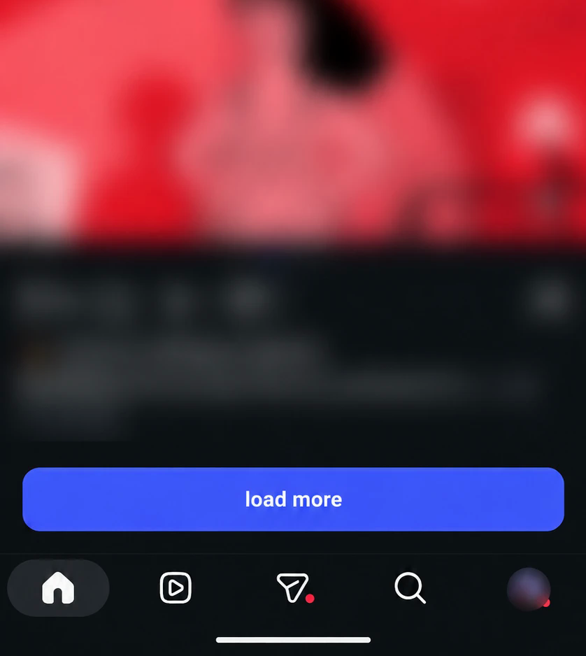

# unrotapps

[English](README.md)

**У бесконечной ленты появляется конец. Иди потрогай траву.**


<p align="center">
  
  <br>
  <sub>Главная лента Instagram после unrotapps: одна страница, дальше решаешь ты.</sub>
</p>

Ты открываешь Instagram, чтобы ответить на одно сообщение. Через двадцать минут ты всё ещё листаешь. Дело не в слабой силе воли: бесконечную ленту и свайп к следующему ролику делают команды, чья работа — удержать тебя в приложении. И у них это хорошо получается.

Удалять приложение ты, скорее всего, не хочешь: там друзья и переписки. Не хватает только конца. unrotapps позволяет ИИ-ассистенту убрать то, на чём ты залипаешь, и не трогать всё остальное.

## Было и стало

| | Было | Стало |
|---|---|---|
| Главная лента | Не кончается | Одна страница, дальше кнопка **Load more** |
| Reels | Свайп, ролик, свайп, ролик | Смотришь только тот, что открыл |
| Вкладка Reels | Открывается на автомате | Вместо неё открывается другое приложение |
| Что в ленте | Выбирает алгоритм | Режим «подписки» или «по времени», если он есть в приложении |
| Уведомления | Все подряд | Только те, что ты оставил |

## Быстрый старт

1. **Установи.** Положи папку `unrotapps` в папку скиллов своего ассистента:
   - Claude Code: `~/.claude/skills/unrotapps/`
   - Codex: `~/.codex/skills/unrotapps/`

   Пользуешься обоими? Держи одну копию и сделай симлинк:

   ```bash
   ln -s ~/.codex/skills/unrotapps ~/.claude/skills/unrotapps
   ```

2. **Вызови.** В Claude Code напиши `/unrotapps`, в Codex — `$unrotapps`. В Claude Code можно и просто описать задачу.

3. **Расскажи, что бесит.** На любом языке:

   ```text
   /unrotapps Лёгкий режим, Instagram на Android. Сообщения и профили не трогай.
   Пусть следующая страница главной ленты грузится только по кнопке Load more,
   а Reels не листаются подряд.
   ```

Сначала ассистент проверяет настройки самого приложения. Если они не помогают, разбирается в приложении, вносит минимальное изменение и проверяет его на твоём телефоне.

## Два режима

**Лёгкий** оставляет все функции и кнопки. Листаешь то, что загрузилось, а следующая страница — по **Load more**. Конкретный ролик открыть можно, а пролистать к следующему — нет.

**Продвинутый** отключает входы в функцию, от которой хочешь избавиться. Кнопка может ничего не делать, открывать другое приложение или показывать твоё напоминание. Если нужно закрыть функцию полностью, ассистент проверит и другие пути в неё: ссылки, карточки, сообщения.

Порядок постов, реклама и уведомления — отдельные вопросы. Ни один режим их не трогает, пока ты сам не попросишь.

<details>
<summary><b>Ещё примеры</b></summary>

```text
/unrotapps Продвинутый режим. Отключи вкладку с короткими
видео и показывай по нажатию моё напоминание: «Зачем я сюда зашёл?».
Проверь другие пути в этот раздел. Сообщения должны работать.
```

```text
/unrotapps Проверь, может ли приложение показывать посты
моих подписок по времени. Уведомления о личных сообщениях оставь,
а уведомления с рекомендациями по возможности выключи.
```

Если знаешь версию приложения, укажи её и назови экраны, которые хочешь поменять. Если не знаешь — ассистент поможет её узнать.

</details>

## Частые вопросы

**Меня забанят?**
Гарантий нет. Изменённые клиенты нарушают правила Instagram, а некоторые приложения умеют их распознавать. Изменённое приложение ставится отдельным клоном со своим входом, но аккаунт-то тот же. Решать тебе.

**Нужен root?**
Нет, хватит отладки по USB. Скилл прямо запрещает ассистенту рутовать телефон и разблокировать загрузчик.

**А на iPhone?**
Подробная инструкция есть только для Android. На iOS, в вебе и на компьютере ассистент может пользоваться только настройками и официальными способами расширить приложение.

**Что будет после обновления приложения?**
Клон — отдельное приложение, поэтому обновления из магазина его не затронут, но и новые версии сам он не получит. Под новую версию придётся разбираться заново. Старые заметки помогут, но вслепую их применять нельзя.

**С оригинальным приложением ничего не случится?**
Оригинал остаётся на месте. Данные приложения не стираются ради обхода ошибок установки. Пароли, PIN-коды и отпечаток вводишь только ты и только на телефоне.

<details>
<summary><b>Настройка Android</b></summary>

Понадобятся компьютер, на котором можно запускать инструменты, USB-кабель с передачей данных (не только для зарядки) и телефон с включённой **отладкой по USB**. Разблокируй телефон и подтверди на нём запрос на отладку.

Скорее всего, скачивать APK не придётся. Ассистент обычно может скопировать установленное приложение прямо с телефона, вместе с дополнительными файлами — *split APK*. Лучше всего брать официальную копию с телефона или от разработчика. Скилл проверяет, откуда взялся файл и совпадают ли подписи.

Если для изменения приложение нужно переподписать, рядом с официальным появится отдельный клон. В клоне может понадобиться заново войти в аккаунт, а некоторые приложения отказываются работать с изменёнными клиентами. Чтобы потом обновить клон, нужен тот же ключ подписи.

Пошаговая инструкция: [настройка Android, извлечение APK и установка](references/android-device.md) (технические инструкции скилла на английском).

</details>

<details>
<summary><b>Что будет в конце сессии</b></summary>

Ассистент должен прямо сказать, что он поменял, что проверил на телефоне, что подтвердил только по коду и что осталось непонятным. Если он собрал приложение для установки, то скажет, где лежит файл и установлен ли он.

Проверка подписи показывает, откуда взялся файл, но это не полная проверка на вирусы. Часть поведения задаёт сервер, и на телефоне это не поменять.

</details>

---

Цель простая: открыть приложение ради того, что нужно, дойти до конца и самому решить, листать ли дальше.
